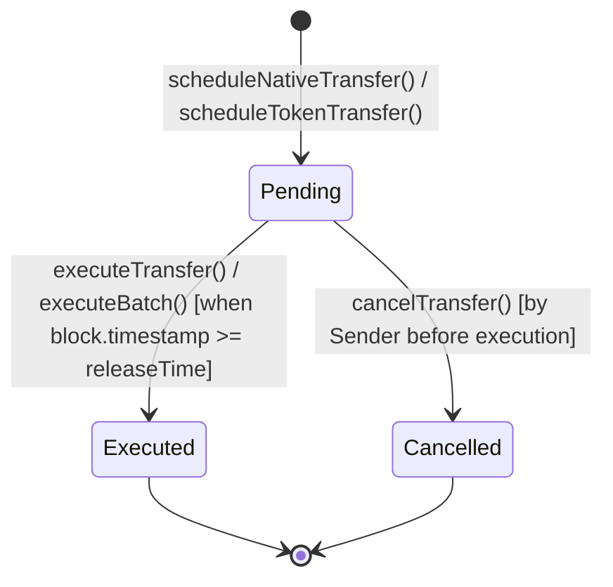

# BOT Scheduled Transfer Protocol
## Whitepaper: Non-Custodial Time-Locked Escrow & Automated Settlement on BotChain

**Version**: 1.0.0  
**Network**: BotChain Mainnet (Chain ID: `677`)  
**Native Gas Coin**: `BOT` (Total Supply: 150 Million)  
**Contract Address**: `0x4e82db1e7fe4a3104677a8ca7f27eb4f982e74ac`  
**Explorer**: [https://scan.botchain.ai](https://scan.botchain.ai/)  

---

## 1. Executive Summary

The **BOT Scheduled Transfer Protocol** is a decentralized, non-custodial smart contract infrastructure deployed on BotChain. It enables individuals, enterprises, and payroll operators to schedule value transfers that unlock and settle automatically at a designated future timestamp.

By pairing time-locked smart contract escrow with permissionless keeper execution bounties, the protocol resolves the inherent EVM limitation where smart contracts cannot self-execute on a future deadline without external transactions.

---

## 2. Problem Statement

### 2.1 The EVM Autonomous Execution Barrier
Ethereum and EVM-compatible blockchains are passive state machines: code is only executed when triggered by an externally owned account (EOA) or transaction. As a result:
- **No Native Cron or Alarms**: Smart contracts cannot wake themselves up at a given block timestamp.
- **Counterparty Insolvency**: Traditional "off-chain scheduled transfers" only record an intent. If the sender withdraws or spends their funds before the due date, execution fails.
- **Custodial Risk**: Centralized payroll or escrow services custody user private keys or pooled funds, introducing single points of failure, regulatory exposure, and operational risk.

### 2.2 The Solution
The BOT Scheduled Transfer Protocol combines:
1. **Immediate Escrow Locking**: When a transfer is scheduled, funds are locked inside the smart contract immediately.
2. **Deterministic Release Verification**: Transfers cannot be executed by anyone before `block.timestamp >= releaseTime`.
3. **Incentivized Keeper Execution**: A built-in native BOT gas reward enables automated bot networks, relayers, or the recipient to trigger execution upon maturity.
4. **Creator Cancellation Rights**: Pending transfers remain revocable by the original scheduler until execution, granting full refund capability.

---

## 3. Protocol Architecture & Asset Support

### 3.1 Dual-Asset Engine
The protocol provides first-class support for both assets on BotChain:

1. **Native BOT Coin (`address(0)`)**:
   - Transferred via `msg.value` at schedule time.
   - Main payment and optional keeper reward are locked in contract balance.
   - Payout uses low-level call (`recipient.call{value: amount}`) protected by `ReentrancyGuard`.
2. **ERC-20 Tokens**:
   - Deposited via OpenZeppelin's `SafeERC20.safeTransferFrom`.
   - Token amount is locked in contract balance.
   - Optional keeper bounty is deposited in native BOT (`msg.value == keeperReward`), ensuring execution callers receive native gas coins regardless of the token transferred.

### 3.2 Transfer State Lifecycle



- **`Pending` (0)**: Funds locked in contract escrow. Countdown active.
- **`Executed` (1)**: Funds disbursed to recipient. Keeper bounty disbursed to caller. State finalized.
- **`Cancelled` (2)**: Funds and bounty refunded back to the sender. State finalized.

---

## 4. Execution Engine & Automation

### 4.1 Permissionless Execution
Execution of a mature transfer is completely permissionless:
- **The Recipient** can execute directly to claim their funds.
- **The Sender** can execute early after the deadline.
- **Decentralized Keepers & Bots** can monitor on-chain transfer deadlines and trigger execution automatically in exchange for the attached `keeperReward`.

### 4.2 Batch Processing for Payroll & Operations
For corporate payrolls and enterprise billing, executing hundreds of individual transfers sequentially incurs unnecessary gas overhead. The protocol provides:
```solidity
function executeBatch(uint256[] calldata transferIds) external nonReentrant;
```
Batching aggregates executions into a single atomic transaction, saving base transaction overhead and streamlining operations.

---

## 5. Security & Risk Analysis

| Vector | Mitigation Strategy |
| :--- | :--- |
| **Reentrancy** | All external state transitions utilize OpenZeppelin `ReentrancyGuard` with strict Checks-Effects-Interactions pattern (state updated to `Executed` / `Cancelled` prior to token transfers). |
| **Insolvency Risk** | Eliminated via upfront escrow locking at schedule time (`msg.value == amount + keeperReward` or `safeTransferFrom`). |
| **Unauthorized Cancellation** | Enforced on-chain: `require(msg.sender == t.sender, "Only sender can cancel")`. Recipient or third parties cannot cancel. |
| **Front-Running / MEV** | Execution parameters and payout recipients are hardcoded in the transfer struct. Front-running execution only accelerates fund delivery to the legitimate recipient while rewarding the caller. |
| **Rounding & Token Precision** | Dynamic token decimals inspection ensures compatibility with standard 18, 6, or custom decimal ERC-20 tokens. |

---

## 6. On-Chain Contract Interface

### Core Methods:
- `scheduleNativeTransfer(address recipient, uint256 amount, uint256 releaseTime, uint256 keeperReward, string calldata note) payable returns (uint256)`
- `scheduleTokenTransfer(address token, address recipient, uint256 amount, uint256 releaseTime, uint256 keeperReward, string calldata note) payable returns (uint256)`
- `executeTransfer(uint256 transferId)`
- `executeBatch(uint256[] calldata transferIds)`
- `cancelTransfer(uint256 transferId)`

### View Methods:
- `getTransfer(uint256 transferId) view returns (Transfer memory)`
- `totalTransfers() view returns (uint256)`
- `getAllTransferIds() view returns (uint256[] memory)`
- `getTransfersByIds(uint256[] calldata ids) view returns (Transfer[] memory)`
- `getTransfersPaginated(uint256 offset, uint256 limit) view returns (Transfer[] memory, uint256)`

---

## 7. Real-World Applications

1. **Enterprise Payroll**: Schedule bi-weekly or monthly employee payouts in advance.
2. **Contractor Milestone Escrow**: Lock payment for a deliverable due next week; automatically released on schedule.
3. **Decentralized Subscriptions & Retainers**: Fund scheduled payments for service providers with automated settlement.
4. **Vesting & Time-Locked Grants**: Schedule future token disbursements with transparent public tracking.

---

## 8. Network Configuration

| Parameter | Specification |
| :--- | :--- |
| **Network Name** | BotChain Mainnet |
| **Chain ID** | `677` |
| **RPC Endpoint** | `https://rpc.botchain.ai` |
| **Native Currency** | `BOT` (18 Decimals • Total Supply: 150 Million) |
| **Block Explorer** | `https://scan.botchain.ai/` |
| **Contract Address** | `0x4e82db1e7fe4a3104677a8ca7f27eb4f982e74ac` |

---

## 9. Conclusion
The BOT Scheduled Transfer Protocol establishes a trust-minimized, capital-guaranteed scheduling framework natively on BotChain. By combining immediate escrow custody with decentralized keeper bounties, it delivers automated payments without custodial risk or counterparty default.
